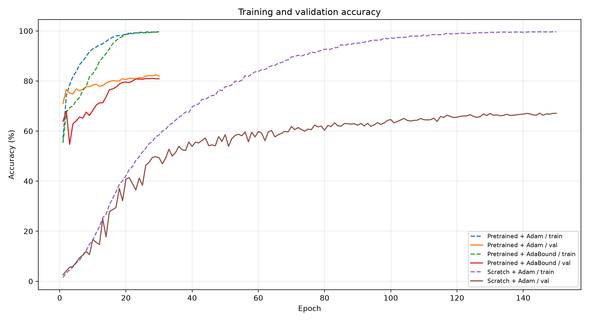
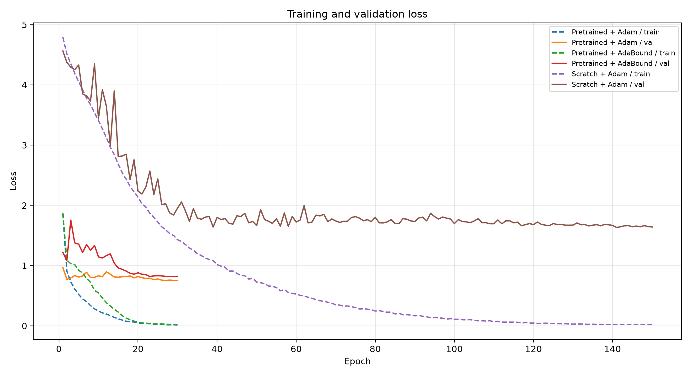
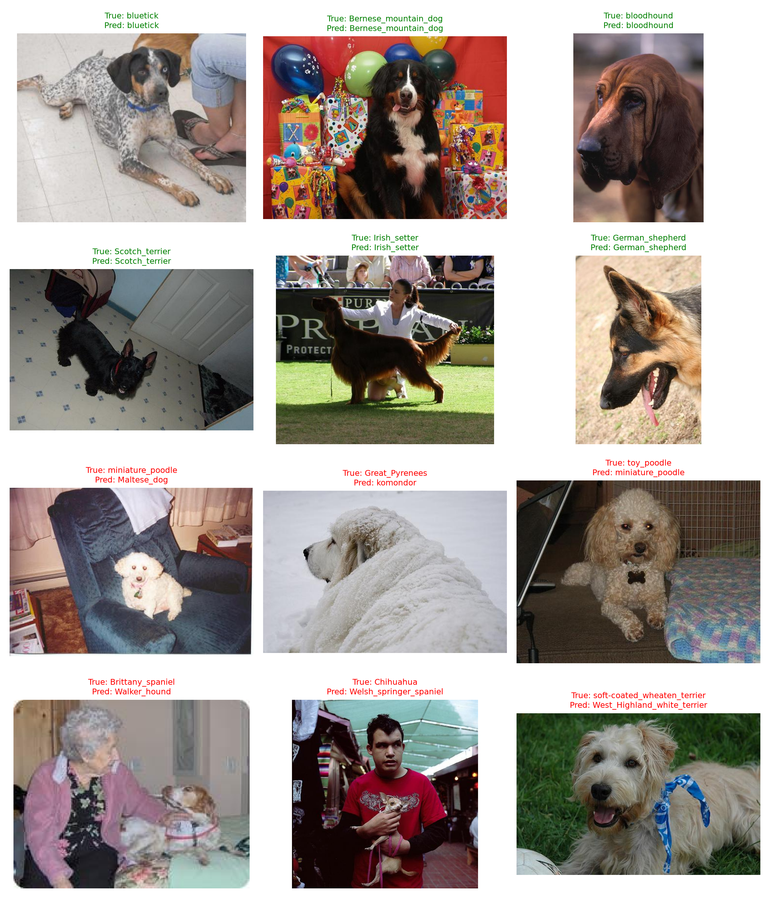

# Классификация Stanford Dogs с помощью ResNet-101

Лабораторная работа № 1, вариант 11. Исследование ResNet-101 при дообучении с предобученными весами и обучении с нуля. Для сравнения оптимизаторов используются Adam и AdaBound.

## Данные

[Stanford Dogs Dataset](https://www.kaggle.com/datasets/jessicali9530/stanford-dogs-dataset/data) — 20 580 изображений, 120 пород собак.

Выборки разделены стратифицированно, с фиксированным `random_state=42`:

| Выборка | Изображений | Доля |
|---|---:|---:|
| Обучающая | 14 406 | 70% |
| Валидационная | 3 087 | 15% |
| Тестовая | 3 087 | 15% |

Разбиение сохраняется в `data/splits.json` и используется во всех экспериментах. Пересечений между выборками нет.

Для обучающей выборки применяются `Resize(256)`, `RandomCrop(224)`, `RandomHorizontalFlip` и `RandomAffine` (поворот до 10°, сдвиг до 5%). Для валидации и теста — `Resize(256)` и `CenterCrop(224)`. Далее изображения преобразуются в тензоры и нормализуются по среднему и стандартному отклонению ImageNet.

## Модель и обучение

Используется ResNet-101 из `torchvision`. Последний полносвязный слой заменён на `Linear(2048, 120)`. В экспериментах с переносом обучения загружаются веса `IMAGENET1K_V1`; все слои сети дообучаются, без заморозки. В третьем эксперименте та же архитектура инициализируется случайными весами.

| Эксперимент | Инициализация | Оптимизатор | Learning rate | Макс. эпох |
|---|---|---|---:|---:|
| `pretrained-adam` | ImageNet-1K | Adam | 0.0001 | 30 |
| `pretrained-adabound` | ImageNet-1K | AdaBound | 0.0001 | 30 |
| `scratch-adam` | Случайная | Adam | 0.0003 | 150 |

Общие настройки:

- Размер входа — 224 × 224; batch size — 32.
- Функция потерь — `CrossEntropyLoss`.
- `weight_decay=0.0001`, планировщик `CosineAnnealingLR` (`eta_min=1e-6`).
- Смешанная точность при обучении на CUDA.
- Ранняя остановка: 10 эпох без улучшения для предобученных моделей (не раньше 12-й эпохи), 15 — для обучения с нуля (не раньше 30-й).
- Лучшая модель сохраняется по Accuracy на валидационной выборке.

Эксперименты проводились на NVIDIA GeForce RTX 3060 Laptop GPU с использованием PyTorch и CUDA.

## Результаты

Метрики рассчитаны на тестовой выборке из 3 087 изображений. Для Precision, Recall и F1 используется усреднение `macro`: метрика вычисляется для каждой породы отдельно, затем берётся среднее по 120 породам.

| Модель | Accuracy | Precision macro | Recall macro | F1 macro |
|---|---:|---:|---:|---:|
| ResNet-101 + Adam (pretrained) | **82.67%** | **82.74%** | **82.27%** | **82.09%** |
| ResNet-101 + AdaBound (pretrained) | 80.53% | 80.72% | 80.10% | 79.96% |
| ResNet-101 + Adam (scratch) | 66.02% | 65.87% | 65.60% | 65.23% |

В данном эксперименте лучший результат показала предобученная ResNet-101 с Adam. По тестовой Accuracy она опередила AdaBound на 2.14 процентного пункта, а модель без предобучения — на 16.65 п. п. Эти результаты относятся к выбранному разбиению данных и параметрам обучения.

### Графики обучения





### Примеры классификации

Примеры верных и ошибочных предсказаний модели `pretrained-adam`:



Матрицы ошибок сохранены в `results/*_confusion.png` и `results/*_confusion.csv`. Численные метрики всех трёх моделей находятся в `results/test_metrics.json`, а история обучения — в отдельных JSON-файлах экспериментов.

## Запуск

Требуется Python 3.12. Приведённые ниже команды выполняются из корня проекта. В `requirements.txt` зафиксированы основные зависимости проекта, но не отдельные низкоуровневые пакеты CUDA: они устанавливаются автоматически при установке подходящей сборки PyTorch.

### 1. Создать виртуальное окружение

**Linux / macOS:**

```bash
python3.12 -m venv .venv
source .venv/bin/activate
python -m pip install --upgrade pip
```

**Windows (PowerShell):**

```powershell
py -3.12 -m venv .venv
.venv\Scripts\Activate.ps1
python -m pip install --upgrade pip
```

### 2. Установить PyTorch под нужное устройство

Для **NVIDIA GPU с совместимым драйвером**, в том числе использованной в исследовании RTX 3060 Laptop GPU, установка воспроизводимой сборки **CUDA 12.8**:

```bash
python -m pip install torch==2.11.0 torchvision==0.26.0 --index-url https://download.pytorch.org/whl/cu128
```

Для **CPU** вместо этого:

```bash
python -m pip install torch==2.11.0 torchvision==0.26.0 --index-url https://download.pytorch.org/whl/cpu
```

### 3. Установить остальные зависимости и проверить CUDA

```bash
python -m pip install -r requirements.txt
python -c "import torch; print('PyTorch:', torch.__version__); print('CUDA build:', torch.version.cuda); print('CUDA доступна:', torch.cuda.is_available()); print('Устройство:', torch.cuda.get_device_name(0) if torch.cuda.is_available() else 'CPU')"
```

В режиме NVIDIA GPU ожидается `CUDA доступна: True`. Если выводится `False`, обучение может перейти на CPU; проверьте драйвер и сборку PyTorch. Для повторения приведённых в работе результатов использованы версии PyTorch 2.11.0, torchvision 0.26.0 и сборка CUDA 12.8.

### 4. Подготовить данные и запустить эксперименты

Скачать Stanford Dogs и распаковать изображения в `data/stanford-dogs/images/Images/`. Далее из корня проекта:

```bash
# Подготовка и сохранение разбиения
python src/data.py

# Обучение трёх конфигураций
python src/train.py --experiment pretrained-adam
python src/train.py --experiment pretrained-adabound
python src/train.py --experiment scratch-adam

# Оценка сохранённых моделей на тесте
python src/evaluate.py

# Графики по истории обучения
python src/plots.py
```

Для тестирования нужны файлы весов в `checkpoints/`, а для построения графиков — истории экспериментов в `results/`. Повторное обучение при наличии сохранённых результатов скрипт `train.py` блокирует, чтобы не перезаписать их случайно.

## Источники

- [Stanford Dogs Dataset](https://www.kaggle.com/datasets/jessicali9530/stanford-dogs-dataset/data)
- [ResNet — Deep Residual Learning for Image Recognition](https://arxiv.org/abs/1512.03385)
- [TorchVision: ResNet-101](https://pytorch.org/vision/stable/models/generated/torchvision.models.resnet101.html)
- [pytorch-optimizer (AdaBound)](https://github.com/kozistr/pytorch_optimizer)
